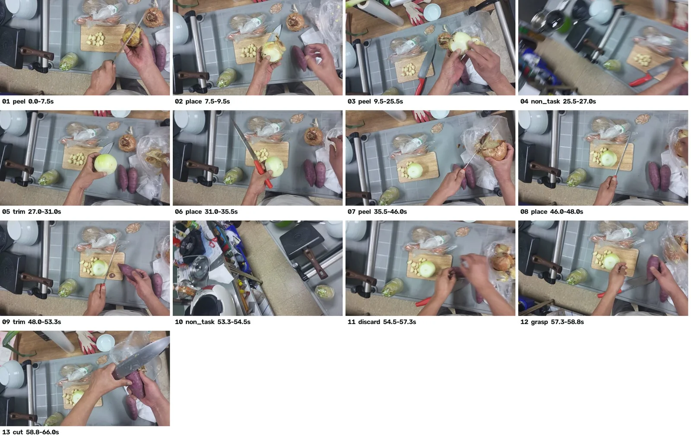
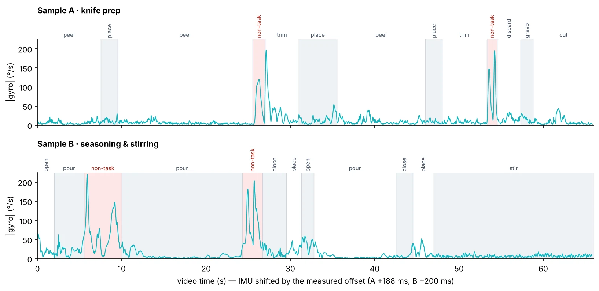
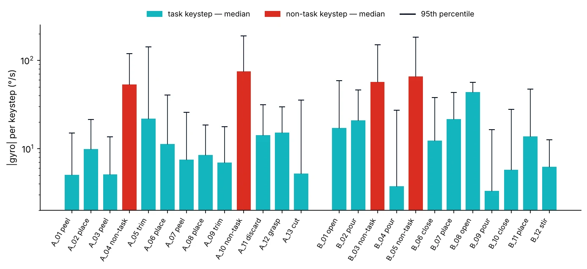
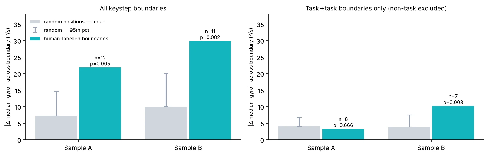
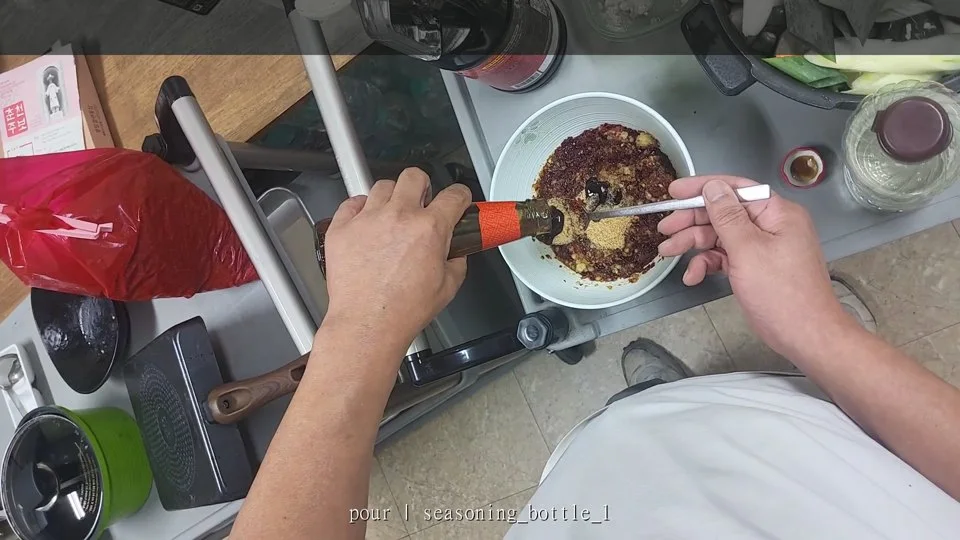

# Keystep Annotation for Egocentric Robot-Learning Data

[](https://origindatalab.io/technical-field-notes/keystep-annotation-egocentric-robot-learning.html)   

**Technical Field Note #05 · Origin Data Lab · 24 October 2026**

**[Technical field note](https://origindatalab.io/technical-field-notes/keystep-annotation-egocentric-robot-learning.html) · [GitHub](https://github.com/origin-data-lab/egocentric-keystep-annotation) · [Hugging Face](https://huggingface.co/datasets/origin-data-lab/egocentric-keystep-annotation)**

> **Research question:** What can structural checks and a body-worn IMU verify about human-labelled egocentric action boundaries?

## At a glance

- **25 human-labelled keysteps** across two cooking clips; **zero reported structural errors**.
- **30 fps** video and **410.6 Hz** native IMU.
- **2,000 random boundary sets** per comparison to contextualize motion changes.
- **Key limitation:** IMU supports review prioritization, not ground-truth validation of subtle hand actions.

## Evaluation samples

| Metric | Sample A — knife preparation | Sample B — seasonings and stirring |
|---|---:|---:|
| Duration | 66.0 s | 65.967 s |
| Frames | 1,979 | 1,978 |
| Keysteps / phases | 13 / 3 | 12 / 3 |
| Gaps / overlaps | 0 / 0 | 0 / 0 |
| Missing required fields | 0 | 0 |
| Out-of-vocabulary verbs | 0 | 0 |

## Visual evidence

### 1 · Keystep frames — knife preparation


### 2 · Keystep timeline and gyroscope


### 3 · Motion within keysteps


### 4 · Boundary comparison with randomized positions


### 5 · Annotation overlay


## Annotation structure

Keysteps are observable action spans nested inside phases and a task. Hand labels refer to the wearer's anatomical hands, not the image side. The instruction describes observed behavior, **not** a robot command.

**Documented example only** — `annotation_example.json` contains `ks_A_01` (0.0–7.5 s), not all 25 keysteps:

```json
{
  "id": "ks_A_01",
  "t_start": 0.0,
  "t_end": 7.5,
  "phase": "onion_A_preparation",
  "verb": "peel",
  "object": "onion_A",
  "tool": "knife",
  "active_hand": "left",
  "support_hand": "right",
  "instruction": "Hold and rotate onion_A with the right hand while removing outer material with a knife in the left hand.",
  "state_before": "onion_A with outer material",
  "state_after": "onion_A partially peeled",
  "outcome": "success"
}
```

## Structural QA

Checks include complete timeline coverage, no overlaps, keysteps within phases, 13 required fields, and allowed action verbs. The source note reports zero errors for these checks in both samples. This is **schema consistency**, not independent semantic ground truth.

## IMU-based boundary evaluation

The app-to-video time alignment offsets reported are **188 ms (A)** and **200 ms (B)**. The score is the absolute change in median gyroscope magnitude across ±1-second windows around a boundary. Each observed boundary set was compared against **2,000** random boundary sets.

| Boundary set | n | Labelled Δ median (°/s) | Random mean | Random p95 | p |
|---|---:|---:|---:|---:|---:|
| A · all | 12 | 21.9 | 7.2 | 14.7 | 0.005 |
| B · all | 11 | 29.9 | 10.0 | 20.1 | 0.002 |
| A · task-to-task | 8 | 3.3 | 4.1 | 6.8 | 0.67 |
| B · task-to-task | 7 | 10.2 | 3.9 | 7.5 | 0.003 |

**Interpretation:** After excluding transitions involving `non_task`, knife-preparation boundaries (A, p=0.67) do not stand out from random boundaries; seasoning boundaries (B, p=0.003) do. The findings should not be generalized beyond this small evaluation.

## Included files

| File | Purpose |
|---|---|
| `annotation_example.json` | One documented, human-readable keystep |
| `evaluation_summary.json` | Sample counts and evaluation context |
| `figures/` | Five figures from the technical field note |

## Scope and limitations

The study covers **two clips from one operator**, not a representative population. Structural QA checks formatting and consistency; it does **not** prove boundary accuracy. A body-worn IMU can reveal coarse wearer motion, but cannot reliably validate fine hand actions such as knife manipulation. **No raw videos, raw IMU streams, or complete 25-keystep annotation files are included in this public release.**

## Citation and contact

**Primary source:** [Origin Data Lab — Technical Field Note #05](https://origindatalab.io/technical-field-notes/keystep-annotation-egocentric-robot-learning.html). Cite this technical note for the methodology; this repository is a supporting evidence package, not a peer-reviewed publication.

**Contact:** [contact@origindatalab.io](mailto:contact@origindatalab.io) · [Origin Data Lab](https://origindatalab.io/)
